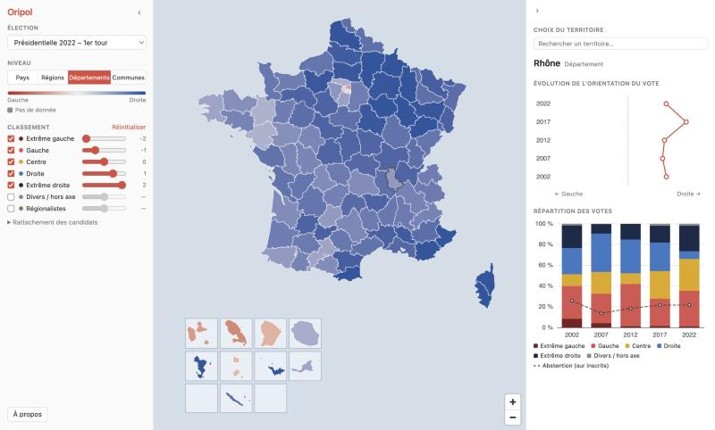
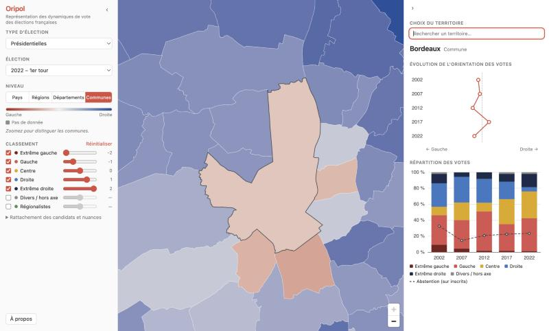
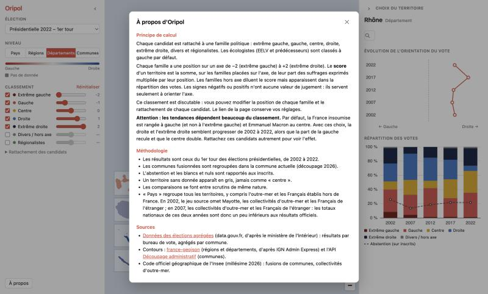

# Oripol

Représentation des dynamiques de vote des élections françaises : une application web qui montre comment un territoire français (commune, département, région, pays) se déplace politiquement d'une élection à l'autre, à partir des résultats officiels.

[](https://github.com/charlescoiffier/oripol/actions/workflows/deploy.yml)

**Voir le site : https://charlescoiffier.github.io/oripol/**

En local : `./start.sh`

Aucun compte, aucun serveur applicatif : le site est statique et tout le calcul se fait dans le navigateur.

## Aperçu

| Départements, présidentielle 2022 | Recherche d'une commune, avec zoom | Principe de calcul et sources |
|---|---|---|
|  |  |  |

---

# Pour tout le monde

## Le projet en bref

Oripol colore une carte de France selon l'orientation du vote (de la gauche à la droite) pour chaque élection, et trace l'évolution d'un territoire dans le temps. Cette version couvre les présidentielles (2002-2022), les législatives (2002-2024), les européennes (1999-2024), les régionales (2004-2021), les départementales (2015-2021), les cantonales (2001-2011) et les municipales (2008-2026), 1er et 2d tours quand il y en a, pour **les 35 000 communes**, les départements, les régions, l'outre-mer et les Français établis hors de France.

Le classement des candidats par famille politique est proposé par défaut, mais chacun peut le modifier.

## Utiliser la carte

0. Choisir le **mode** sous le titre : **Classique** (chaque territoire prend la couleur de la famille de la liste arrivée en tête ; le panneau de droite liste les candidats ou nuances avec voix, pourcentages et abstention ; dans une commune, chaque liste est détaillée séparément, avec son candidat ou sa tête de liste (législatives, régionales, municipales ; présidentielles : le candidat), et la commune prend la couleur de la famille de la liste arrivée en tête ; pour un département, une région ou le pays, les voix sont regroupées par nuance) ou **Évolution** (orientation moyenne des votes et trajectoire du territoire).
1. Choisir un **type d'élection** (présidentielles, européennes, législatives, régionales, départementales et cantonales, municipales), puis l'**élection** précise dans le second menu, dans le panneau de gauche. Changer de type garde la même année quand elle existe.
2. Choisir un **niveau** : Pays, Régions, Départements ou Communes. Au niveau Communes, il faut zoomer pour distinguer les communes.
3. Cliquer sur un territoire (il est entouré d'un trait fin), ou le chercher dans la barre « Choix du territoire » du panneau de droite : la liste se réduit pendant la frappe. Choisir un résultat le valide, bascule sur le niveau qui lui correspond et zoome dessus. Un double clic sur un territoire zoome sur son emprise.
4. Lire sa fiche : **évolution de l'orientation des votes** depuis 2002, puis **répartition des votes** par famille, avec l'abstention. Passer la souris sur une année ouvre une fenêtre avec l'élection, le territoire, le nombre de votants (et la participation), celui des abstentions et celui des blancs. Avant 2017, le fichier source ne distingue pas les blancs des nuls : la fenêtre indique alors « Blancs et nuls ».

Quand on change de niveau, la sélection suit : en passant à un niveau supérieur (par exemple d'une commune à son département), le territoire parent est sélectionné et la carte zoome dessus ; en passant à un niveau inférieur, le territoire reste affiché dans la fiche et la carte zoome sur son emprise pour montrer ses subdivisions. « Pays » revient à la vue d'ensemble à chaque clic.

Dans la fiche, les années sont empilées (la plus ancienne en haut) et la courbe se place de part et d'autre de la ligne médiane : la gauche à gauche, la droite à droite. Chaque scrutin comparable garde sa date : une croix grise sur la ligne médiane (et une barre en pointillés dans la répartition) signale un scrutin sans résultat pour ce territoire, par exemple une élection pliée au premier tour ; un cercle gris creux signale une orientation moyenne non calculée faute de voix étiquetées (municipales). Les points apparaissent progressivement quand on change de territoire. L'orientation est exprimée par une nuance : gauche, centre gauche, centre, centre droit, droite. Un clic dans la mer quitte la sélection.

Les territoires d'outre-mer sont placés dans la carte elle-même, en bas à gauche de la métropole, chacun dans son cadre : Guadeloupe, Martinique, Guyane, La Réunion, Mayotte, Saint-Pierre-et-Miquelon, Saint-Barthélemy, Saint-Martin, Polynésie française, Nouvelle-Calédonie et Wallis-et-Futuna. Leur position et leur échelle sont arbitraires (c'est un encart, pas une vraie géographie). Passer la souris sur un territoire affiche son nom (« France » au niveau Pays). Les deux panneaux latéraux se replient avec les flèches `‹` et `›`.

## Comprendre l'orientation moyenne

- Chaque candidat (présidentielles) ou chaque nuance politique du ministère de l'Intérieur (législatives) est rattaché à une famille : extrême gauche, gauche, centre, droite, extrême droite, divers, régionalistes. Les écologistes (EELV et prédécesseurs) sont classés à gauche par défaut.
- Chaque famille occupe une position sur un axe de `-2` (extrême gauche) à `+2` (extrême droite). Les signes servent seulement à orienter l'axe, ils n'ont aucune valeur de jugement.
- L'**orientation moyenne** d'un territoire (son « score ») est la position moyenne de ses suffrages : la somme, sur les familles placées sur l'axe, de leur part des suffrages exprimés multipliée par leur position. Dans les graphiques, elle est traduite en nuance : gauche, centre gauche, centre, centre droit, droite. Les familles divers et régionalistes sont placées par défaut à `0`, au milieu de l'axe : leurs voix pèsent dans la moyenne comme celles du centre. Elles apparaissent aussi dans la répartition des votes.
- La couleur de la carte sature à `±0,6` et monte vite aux faibles écarts : un territoire fortement orienté n'a pas besoin d'atteindre `±2`, et un territoire peu orienté reste nettement coloré. Un territoire sans donnée est gris foncé.

## Partager et exporter

En bas du panneau de gauche, « Partager et exporter » propose : **Copier le lien** (l'adresse conserve élection, territoire, mode, niveau et classement) ; **Image PNG** (carte cadrée sur le territoire sélectionné, légende et graphiques au choix) ; **PDF A4** (tout sur une page). La case « Palette adaptée aux daltoniens » recolore la carte et les familles. Sur un écran étroit, les panneaux s'empilent les uns sous les autres.

## Ajuster le classement

Le classement n'est qu'une proposition. Dans le panneau de gauche, on peut :

- déplacer le curseur d'une famille, ou la sortir de l'axe en décochant sa case ;
- rattacher un candidat à une autre famille (section « Rattachement des candidats ») ;
- revenir au classement d'origine avec « Réinitialiser ».

La carte et les courbes se recalculent aussitôt. L'adresse de la page conserve tous les réglages : il suffit de la copier pour partager une vue.

## Limites des données

- Les communes fusionnées sont regroupées dans la commune actuelle (découpage 2026).
- L'abstention, les blancs et les nuls sont rapportés aux inscrits.
- Un territoire sans donnée apparaît en gris, jamais comme « centre ».
- Les tendances dépendent beaucoup du classement : avec les choix par défaut (La France insoumise à gauche, Emmanuel Macron au centre), la droite et l'extrême droite semblent progresser de 2002 à 2022. Rattacher ces candidats autrement change nettement la courbe.
- Le jeu source est incomplet pour deux scrutins : en 2002 il omet Mayotte, les collectivités d'outre-mer et les Français de l'étranger ; en 2007, les collectivités d'outre-mer et les Français de l'étranger. Le total « Pays » de ces deux années est donc un peu inférieur au résultat officiel.
- **Municipales** : seules les communes d'une certaine taille ont des nuances politiques (environ 3 500 habitants et plus en 2008 et 2026, environ 1 000 et plus en 2014 et 2020). Les autres voix sont « Non classé », hors du calcul de l'orientation, qui n'est faite que si au moins 30 % des voix sont étiquetées ; les petites communes sont donc en gris, et les totaux départementaux et nationaux reflètent surtout les communes étiquetées. Dans la fenêtre au survol, une ligne indique la part de voix étiquetées.
- Au 2d tour, seules les communes concernées par un second tour ont des résultats ; cantonales et départementales ne renouvellent qu'une partie des cantons à chaque scrutin, le reste de la carte est en gris.

---

# Pour les développeurs

## Démarrage

Prérequis : [uv](https://docs.astral.sh/uv/), Node.js et [tippecanoe](https://github.com/felt/tippecanoe) (`brew install uv tippecanoe`).

```bash
./start.sh        # génère les données si besoin, lance le serveur et ouvre la page
./build-data.sh   # (re)génère seulement les données : ~240 Mo téléchargés la première fois
```

Les résultats de chaque élection ne sont chargés qu'à la demande (environ 2 Mo chacune, une centaine de Mo pour les 56 élections). Les données générées (`web/static/data/`) et les sources téléchargées (`etl/data/`) ne sont pas versionnées : tout ce qui peut être régénéré est exclu du dépôt.

Avec Node 23.5, `npm install` doit recevoir `--engine-strict=false` (c'est ce que fait `start.sh`).

## Architecture

```
sources officielles (parquet, CSV)
  → ETL Python (polars) : codes communes, fusions, rattachement candidat → famille, contrôles
  → JSON compacts par élection + contours PMTiles
  → site statique SvelteKit : MapLibre (cartes) + ECharts (courbes), score calculé dans le navigateur
```

- **ETL** (`etl/`) : lit les fichiers, résout les fusions de communes avec l'historique des mouvements du COG, rattache les candidats ou les nuances à une famille (`etl/mappings/` : `families.yaml`, `presidentielle.yaml` par candidat, `nuances.yaml` par nuance du ministère pour tous les autres scrutins, `europeennes-2019.yaml` par liste), agrège commune → département → région → pays, puis **échoue sans rien écrire** si la somme des voix d'une commune diffère des exprimés ou si un candidat n'a pas de famille.
- **Site** (`web/`) : charge les résultats bruts et recalcule le score à chaque réglage, ce qui rend le classement ajustable sans serveur. Les contours sont des tuiles PMTiles ; la couche des 35 000 communes n'est embarquée qu'à partir du zoom 6.
- **Outre-mer** : `etl/src/oripol_etl/inset.py` déplace et met à l'échelle chaque territoire dans un cadre au sud-ouest de la métropole, en conservant sa forme réelle (conversion longitude → distance selon la latitude).
- **Territoires** : identifiants `FR`, `REG-<code>`, `DEP-<code>` et `COM-<code INSEE>`. Les collectivités d'outre-mer sont à la fois leur propre département et leur propre région ; les Français de l'étranger forment le département fictif `DEP-ZZ`, sans carte.

## Sources de données

| Donnée | Source | Usage |
|---|---|---|
| Résultats par bureau de vote | [Données des élections agrégées](https://www.data.gouv.fr/datasets/6481e741d4cf002ec0efec9d) (data.gouv.fr, d'après le ministère de l'Intérieur) | Résultats, agrégés par commune |
| Fusions de communes, outre-mer | Code officiel géographique de l'Insee, millésime 2026 | Résolution des codes, collectivités d'outre-mer |
| Régions et départements de métropole | [france-geojson](https://github.com/gregoiredavid/france-geojson) (d'après IGN Admin Express) | Contours |
| Communes, départements et régions d'outre-mer | API [Découpage administratif](https://geo.api.gouv.fr) | Contours (les DOM sont fusionnés depuis leurs communes, puis déplacés dans l'encart) |

## Paramètres d'URL

| Paramètre | Rôle | Exemple |
|---|---|---|
| `e` | Élection | `e=pres-2022-1` |
| `t` | Territoire sélectionné | `t=DEP-69`, `t=COM-69123`, `t=FR` |
| `v` | Niveau (`pays`, `regions`, `departements`, `communes`) ; `departements` par défaut | `v=communes` |
| `p` | Positions modifiées, `famille~valeur` séparés par des virgules (`x` = hors axe) | `p=gauche~-0.5,divers~x` |
| `l` | Rattachements modifiés, `liste~famille` séparés par des virgules | `l=pres-2022-1.MACRON~droite` |

Les paramètres invalides sont ignorés sans erreur.

## Structure du dépôt

| Dossier | Contenu |
|---|---|
| `etl/src/oripol_etl/` | Pipeline : `cog`, `geo`, `ministry`, `families`, `aggregate`, `validate`, `export` |
| `etl/scripts/` | Téléchargement des sources et construction des contours |
| `etl/mappings/` | Familles et rattachement des candidats (données à relire avant publication) |
| `web/src/lib/` | Logique pure (`score`, `series`, `search`, `hierarchy`, `url-state`) et composants Svelte |
| `docs/` | Spécification, plan d'implémentation et captures d'écran |

## Tests

```bash
uv run --project etl pytest etl/tests   # ETL : résolution des fusions, agrégation, contrôles, export
npm --prefix web test                    # logique du site : score, URL, couleurs, recherche, séries, hiérarchie
npm --prefix web run check               # vérification des types
```
